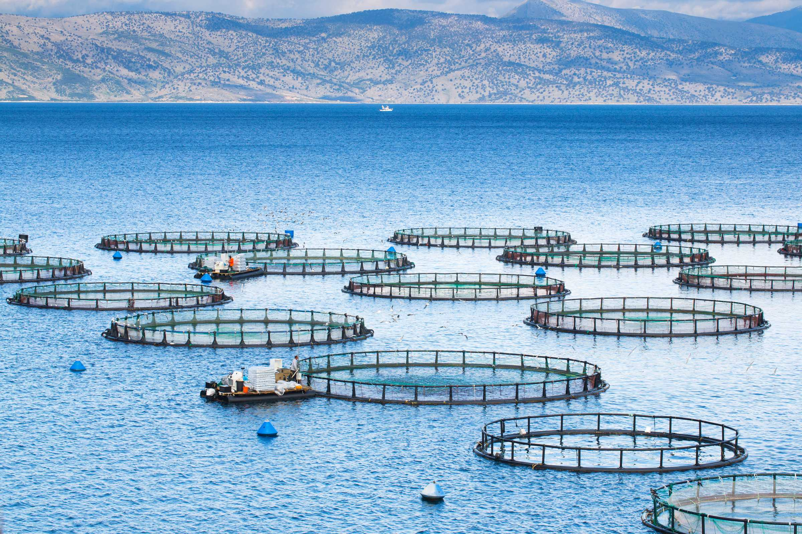

# Marine Aquaculture Suitability Function for Given and Chosen Species
## EDS 223: Assignment 3

<p align="center">
  
</p>

# Purpose of Repository 

This repository contains the materials for the [third homework assignment](https://eds-223-geospatial.github.io/assignments/HW3.html) for [EDS 223: Geospatial Analysis and Remote Sensing](https://bren.ucsb.edu/courses/eds-223), a course that is part of the Master of Environmental Data Science program completed at the Bren School of Environmental Science and Management.

# Background

Marine aquaculure can be a sustianable option for growing seafood to meet the growing demand in global food supply and steer from the more resource-intesive option of agricultural meat production (Hall, 2011).

# Data Information and Organization

Information on the oysters and blue mussel for the preferred was found on SeaLifeBase.

The **folders** are organized as the following:

```
EDS223-HWK1 
├── aquaculture_analysis.pdf
├── aquaculture_analysis.qmd
├── data
│   ├── average_annual_sst_2008.tif
│   ├── average_annual_sst_2009.tif
│   ├── average_annual_sst_2010.tif
│   ├── average_annual_sst_2011.tif
│   ├── average_annual_sst_2012.tif
│   ├── depth.tif
│   ├── wc_regions_clean.shp
└── README.md
```

Inside the **data** folder, there are files for the average sea surface temperature from 2008 to 2012 to use for the desired region. 


# Sources

